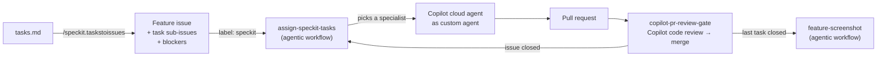

# Lights-out engineering

References and a starter template from the talk **Lights-Out Engineering: how autonomous agent
teams in GitHub Copilot ship code while you sleep** by Michael van der Bend.

> Human-led at the start, autonomous in the middle, human-approved at the end.

- [The flow](#the-flow)
- [The template](#the-template)
- [Get started](#get-started)
- [References](#references)

## The flow

| Step | What happens | Who |
| --- | --- | --- |
| **Specify** | Intent, users, acceptance criteria | You + agent |
| **Clarify & plan** | Architecture and trade-offs | You decide |
| **Tasks** | Small, testable tasks with dependencies | Agent drafts, you check |
| **Execute** | Code, tests and a pull request per task | 🌙 Lights out |
| **Review** | AI review first, then people | You merge |

The first three steps happen locally with a spec-driven development framework such as
[Spec Kit](https://github.com/github/spec-kit). From there, the template in this repo runs the
execution layer on GitHub:



## The template

Copy the contents of [`template/`](template/) into the root of your repository.

| File | What it does |
| --- | --- |
| [`.github/copilot-instructions.md`](template/.github/copilot-instructions.md) | Starter instructions: how to build and test, what to check before a PR, what to leave alone, what to do when unsure. |
| [`.github/agents/*.agent.md`](template/.github/agents/) | Four specialist [custom agents](https://docs.github.com/en/copilot/how-tos/use-copilot-agents/cloud-agent/create-custom-agents): `frontend-engineer`, `backend-engineer`, `design-assets` and `tester`. Each has its own scope, rules and "done when". |
| [`.github/agents/speckit.taskstoissues.agent.md`](template/.github/agents/speckit.taskstoissues.agent.md) | A customized Spec Kit command. It turns `tasks.md` into a feature issue with task sub-issues and native blocked-by dependencies, and only then adds the `speckit` label that starts the workflow. |
| [`.github/workflows/assign-speckit-tasks.md`](template/.github/workflows/assign-speckit-tasks.md) | [Agentic workflow](https://github.github.com/gh-aw/). Runs when a task is labeled or closed, finds tasks with no open blockers, lets an agent pick the right specialist, and assigns the issue to Copilot cloud agent with that custom agent. Max two tasks in parallel. |
| [`.github/workflows/copilot-pr-review-gate.yml`](template/.github/workflows/copilot-pr-review-gate.yml) | When Copilot finishes a PR: mark it ready, request Copilot code review, merge if clean, otherwise ask `@copilot` for one fix round and merge after. |
| [`.github/workflows/feature-screenshot.md`](template/.github/workflows/feature-screenshot.md) | Agentic workflow. When the last task of a feature closes, it starts the app, takes a screenshot, checks each acceptance scenario from the spec and closes the feature issue. |
| [`.github/workflows/copilot-setup-steps.yml`](template/.github/workflows/copilot-setup-steps.yml) | Prepares the cloud agent's environment so it can build and test. |
| `*.lock.yml` | Compiled versions of the agentic workflows. Recompile after every change with `gh aw compile`. |

Lines marked with ✏️ are the places to adapt to your project. The custom agents assume a
`frontend/` + `backend/` layout, so rename or replace them to match yours, and keep the
specialist list in `assign-speckit-tasks.md` in sync.

> [!IMPORTANT]
> The review gate merges pull requests without a human approval. That's the point of the demo,
> but start with it on a sandbox repository, keep branch protection and required checks on
> `main`, and decide which changes still need a person.

## Get started

1. **Copy the template** into your repository.

2. **Install Spec Kit** for GitHub Copilot, keep the customized `speckit.taskstoissues` files from this template:

   ```bash
   uvx --from git+https://github.com/github/spec-kit.git specify init --here --ai copilot
   ```

3. **Install GitHub Agentic Workflows** and compile:

   ```bash
   gh extension install github/gh-aw
   gh aw compile
   ```

4. **Add secrets** to the repository:
   - `GH_AW_AGENT_TOKEN`: a fine-grained personal access token of a user who can assign Copilot
     cloud agent and merge PRs. A user token is needed because events from `GITHUB_TOKEN` don't
     trigger other workflows, and only a user can ask `@copilot` for changes.
   - `COPILOT_GITHUB_TOKEN`: the token the agentic workflows use for the Copilot engine, see the
     [gh-aw documentation](https://github.github.com/gh-aw/).

5. **Enable Copilot cloud agent** for the repository and adapt the lines marked ✏️.

6. **Run the flow:** `/speckit.specify` → `/speckit.clarify` → `/speckit.plan` → `/speckit.tasks`
   → `/speckit.taskstoissues`. Then close your laptop.

**Start small.** You don't need all of this on day one. Take one spec, split it into a few small
issues, and assign them to the cloud agent. Add more only when you see it helps.

## References

### The numbers and the stories

- [GitHub Octoverse 2026](https://github.blog/news-insights/octoverse/octoverse-commits-pushes-reach-new-highs-in-2026-as-developers-build-with-agents/)
- [Ten Months with Copilot Coding Agent in dotnet/runtime](https://devblogs.microsoft.com/dotnet/ten-months-with-cca-in-dotnet-runtime/) (Stephen Toub)
- [Nine engineers, 1,211 pull requests in a day: Lessons from building Copilot Cowork](https://commandline.microsoft.com/how-we-built-copilot-cowork-python-to-rust-migration/) (Bas Brekelmans)
- [METR: task-completion time horizons](https://metr.org/time-horizons/)
- [Building an agentic memory system for GitHub Copilot](https://github.blog/ai-and-ml/github-copilot/building-an-agentic-memory-system-for-github-copilot/)
- [Anthropic: The components of agent memory](https://www.anthropic.com/research/components-of-agent-memory)
- [Evaluating AGENTS.md (ETH Zurich)](https://arxiv.org/abs/2602.11988)

### Frameworks and spec-driven development

- [github/squad](https://github.com/github/squad) · [docs](https://github.github.com/squad/) · [Squad 2.0](https://www.bradygaster.com/writing/squad-2-0/)
- [Squad ceremonies (retros)](https://github.github.com/squad/docs/features/ceremonies/)
- [GitHub Spec Kit](https://github.com/github/spec-kit) · [OpenSpec](https://github.com/Fission-AI/OpenSpec) · [Spec Kit Agents (arXiv)](https://arxiv.org/abs/2604.05278)
- [Birgitta Böckeler: Understanding spec-driven development](https://martinfowler.com/articles/exploring-gen-ai/sdd-3-tools.html)

### Why the spec needs a human

- [FeatBench: vague feature requests, best agent resolves ~30%](https://arxiv.org/abs/2509.22237)
- [Interactive agents for underspecified tasks: asking beats guessing](https://arxiv.org/abs/2502.13069)

### Build it yourself

- [Copilot cloud agent](https://docs.github.com/en/copilot/concepts/agents/cloud-agent)
- [Cloud agent: risks and mitigations](https://docs.github.com/copilot/concepts/agents/coding-agent/risks-and-mitigations)
- [Custom agents](https://docs.github.com/en/copilot/how-tos/use-copilot-agents/cloud-agent/create-custom-agents)
- [GitHub Agentic Workflows](https://github.github.com/gh-aw/)
- [Copilot Memory](https://docs.github.com/en/copilot/concepts/prompting-and-context/copilot-memory) · [Copilot Dreaming](https://docs.github.com/en/copilot/concepts/prompting-and-context/copilot-dreaming)
- [Give your agent a notebook](https://www.michaelvdbend.dev/posts/give-your-agent-a-notebook) · [agent-notebook](https://github.com/mvanderbend-msoft/agent-notebook)

## License

[MIT](LICENSE). The `speckit.taskstoissues` command is adapted from [GitHub Spec Kit](https://github.com/github/spec-kit) (MIT).
